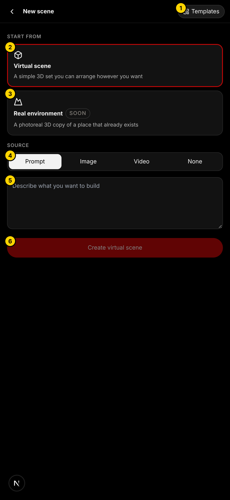
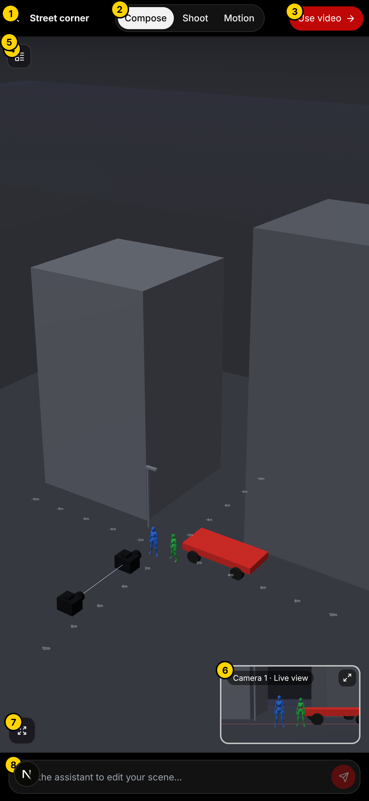
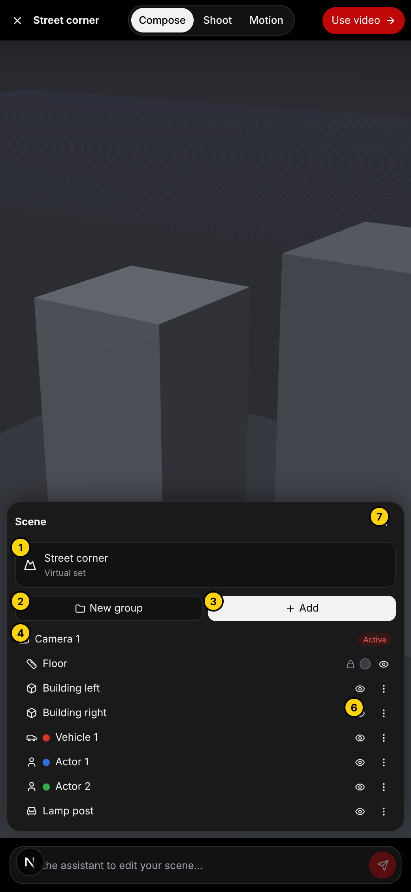
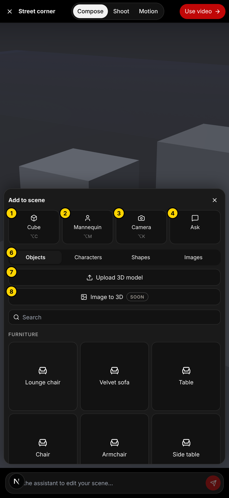
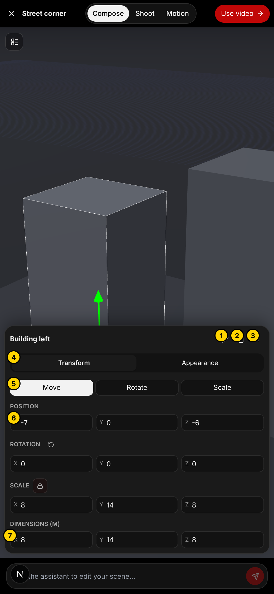
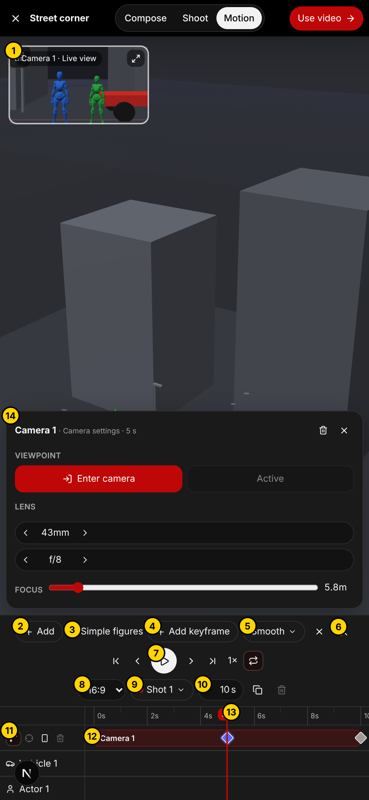
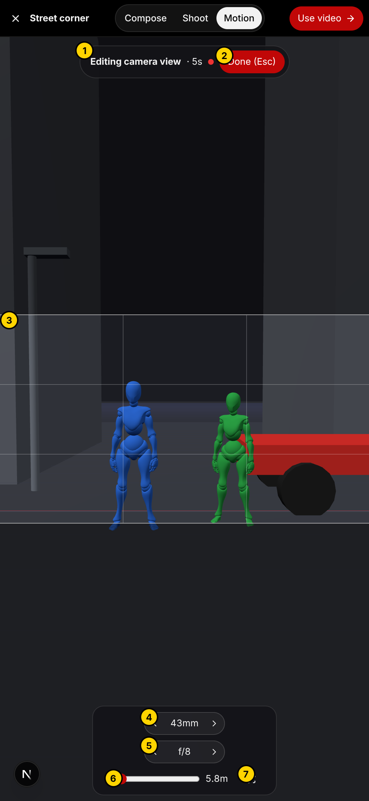
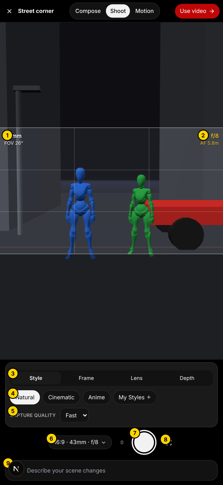
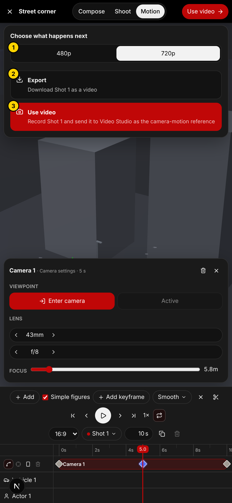

# ShotMap manual

ShotMap lets you build a rough 3D set, plan exactly how the camera moves through it, and send that move to Video Studio so the AI video follows it. The grey shapes are only a guide: the video model turns them into the real thing.

Open it: **Video Studio → pick a finished clip so the tool row appears → ShotMap.**

The numbers on the screenshots are yellow circles. Each section below explains its own numbers.

**The one-minute version**
1. Start a scene (a template is fastest).
2. **Compose**: place things.
3. **Motion**: add keyframes to move the camera.
4. **Use video**: it records the move and opens Video Studio ready to Generate.

---

## 1. Start screen

| # | What it is |
|---|---|
| 1 | **Templates**: ready-made scenes (street corner, living room, mountain summit, boat at sea). Easiest way to begin. |
| 2 | **Virtual scene**: a simple grey 3D set you arrange yourself. This is the one that works today. |
| 3 | **Real environment**: a photoreal copy of a real place. Marked Soon. |
| 4 | **Source**: how the scene starts. **Prompt** (describe it in words), **Image** (pick a picture, or draw one), **Video** (pick a clip), **None** (empty scene). |
| 5 | **Describe your scene**: type what you want. Be specific about places, people and sizes. |
| 6 | **Create virtual scene**: the assistant builds it for you. With **None** the button creates an empty scene instantly. |

Your saved scenes are listed at the bottom of this screen. Scenes are saved automatically on this device, per project.

---

## 2. Compose: build the set

| # | What it is |
|---|---|
| 1 | **X**: close ShotMap. Your scene is saved. |
| 2 | **Compose / Shoot / Motion**: the three modes. Compose = build, Shoot = take stills, Motion = move the camera. |
| 3 | **Use video**: record the camera move and send it on (see section 8). |
| 4 | **Scene list button**: opens the list of everything in the scene. |
| 5 | **The 3D view**: drag to turn around the scene, pinch to zoom, two fingers to slide. Tap a thing to select it. |
| 6 | **Camera preview**: what the camera sees right now. The arrow makes it bigger. |
| 7 | **View tools**: the first button fits everything on screen. When something is selected, **W / E / R** switch between Move, Rotate and Scale. |
| 8 | **Assistant box**: type a change ("add a bench next to the car", "make the buildings taller") and press the red arrow. |

Tip: the small black boxes in the view are camera keyframes, not objects.

---

## 3. The scene list

| # | What it is |
|---|---|
| 1 | Scene name. Tap to rename it. |
| 2 | **New group**: make a folder to keep related things together (a forest, a building). |
| 3 | **Add**: open the Add to scene panel (next section). |
| 4 | **Camera 1**: tap to select the camera. "Active" means this is the one being recorded. |
| 5 | **Eye**: hide or show a thing. Hidden things are not in the recording. |
| 6 | **Three dots**: rename, duplicate, lock, move into a group, delete. |
| 7 | **<**: close the list. |

On a phone the list closes by itself when you pick something, so the 3D view stays visible.

---

## 4. Add to scene

| # | What it is |
|---|---|
| 1 | **Cube** (⌥C on a keyboard). |
| 2 | **Mannequin** (⌥M): a person stand-in. |
| 3 | **Camera** (⌥K): adds another camera on its own shot. |
| 4 | **Ask**: talk to the assistant instead. |
| 5 | **Recent**: things you added lately. |
| 6 | **Tabs**: **Objects** (furniture, props, vehicles), **Characters** (man, woman, or a character picture from your Ingredients), **Shapes** (cube, sphere, cone, wall and more), **Images** (a flat 2D picture standing in the scene). |
| 7 | **Upload 3D model**: add your own .glb file. It stays on this device. |
| 8 | **Image to 3D**: turn a picture into a 3D object. Marked Soon. |

Big things (mountains, buildings, trees) are made from shapes: a wide cone is a mountain, a tall cube is a building.

---

## 5. Inspector: place and resize one thing

Select something and its panel appears.

| # | What it is |
|---|---|
| 1 | Rename. |
| 2 | Delete. |
| 3 | Close the panel. |
| 4 | **Transform / Appearance**. Transform = where and how big. Appearance = colour, and a line saying **what it really is in the video** ("a climber in a red jacket"). That line goes into the prompt, so fill it in. |
| 5 | **Move / Rotate / Scale**: which handle the 3D view shows. |
| 6 | **Position, Rotation, Scale and size**: type exact numbers in metres and degrees. The padlock keeps proportions. |

For a person: Appearance also lets you set the pose, the colour (which names them in the prompt) and **link a character picture** so the video keeps their face and clothes.

---

## 6. Motion: move the camera

You move the camera by placing **keyframes**. A keyframe is the camera's position, aim and lens at one moment. ShotMap glides the camera between them.

| # | What it is |
|---|---|
| 1 | **Camera preview** (stays at the top while you work). |
| 2 | **Add**: add an actor, a cube or another camera. |
| 3 | **Simple figures**: on = people appear in the recording, off = left out. |
| 4 | **Add keyframe**: adds one at the playhead (also **K** on a keyboard, or **double-tap the camera track**). |
| 5 | **Easing**: how the camera speeds up or slows into the selected keyframe. **Smooth** is elegant, **Linear** is constant speed, **Ease In / Out / In-Out** speed up, slow down or both. |
| 6 | **Scissors**: cut the shot into two at the playhead. |
| 7 | **Play / pause**, with previous and next keyframe, start, end, speed (1× / 2× / 0.5×) and loop beside it. |
| 8 | **Aspect ratio** of the frame (16:9, 9:16, 1:1...). |
| 9 | **Shots**: switch between shots, or make a new one. Each shot has its own camera. |
| 10 | **Shot length** in seconds (1 to 30). |
| 11 | **Camera track tools**: show the path, aim at the selected thing, vertical frame, delete camera. |
| 12 | **Keyframe**: tap to select, drag sideways to move it in time. |
| 13 | **Playhead**: drag the ruler to scrub. The number is the time. |
| 14 | **Camera settings**: opens when a keyframe is selected (next section). |

**To make a move:** 1) drag the playhead to 0s and add a keyframe, 2) set up the opening view (Enter camera), 3) move the playhead later, add another keyframe, set up that view, 4) press play to check it.

People and vehicles can move too: double-tap their row on the timeline to add a keyframe, then drag them in the 3D view at that time.

---

## 7. Enter camera: see exactly what the camera sees

Select a keyframe, then press **Enter camera** in its settings.

| # | What it is |
|---|---|
| 1 | Bar showing you are editing a keyframe, and its time. |
| 2 | **Done (Esc)**: save the view into the keyframe. |
| 3 | **The camera frame** with thirds lines. Drag to look around; pinch (or scroll wheel) to move forward and back. On a keyboard: W A S D move, Q and E go down and up. |
| 4 | **Lens** (focal length): small = wide, large = zoomed in. |
| 5 | **Aperture** (f-stop): low numbers blur the background. |
| 6 | **Focus distance** slider. |
| 7 | **Focus picker**: tap it, then tap what must be sharp. It matters most at low f-numbers like f/2.8. |

---

## 8. Shoot: take a finished-looking still

Shoot looks through a camera and turns the grey view into a finished picture, using an image model.

| # | What it is |
|---|---|
| 1 | Lens and field of view. |
| 2 | Aperture and focus distance. |
| 3 | **Style / Frame / Lens / Depth** tabs. |
| 4 | The choices for the open tab: style (Natural, Cinematic, Anime), aspect ratio, lens, aperture. |
| 5 | **Capture quality**: Fast or High. |
| 6 | **Settings row** (aspect · lens · aperture): opens and closes the tabs. |
| 7 | **Shutter**: takes the still. It appears in the strip above as it is made. Tap it to open, tap Download to keep it. |
| 8 | **Focus picker**. |
| 9 | **Describe your scene changes**, plus the paperclip to add reference pictures. |

Stills use credits like any image.

---

## 9. Use video: send the move to Video Studio

| # | What it is |
|---|---|
| 1 | **Quality**: 480p (quick) or 720p. |
| 2 | **Export**: download the camera move as a video file. |
| 3 | **Use video**: records the active shot, then opens Video Studio with Seedance 2.5, the recording as the camera reference, your character pictures and a ready prompt. Press **Generate** there. |

The recording takes a few seconds. The progress box has a Cancel button.

The prompt tells the model to copy only the camera move and where things stand, and to replace every grey shape with the real thing. Add the look you want (place, light, mood) in the Video Studio prompt before generating.

---

## Good habits
- Fill in **"What it is in the video"** for every important thing.
- Start with a template and change it.
- Keep moves simple: two or three keyframes are often enough.
- Check with play before pressing Use video.
- Link a **character picture** to each mannequin so people stay consistent.
- Longer than 30 seconds: make several shots and chain the clips.

## If something looks wrong
- **The floor flickers or stripes**: reload the page; this was fixed in the latest build.
- **The scene list covers the view (phone)**: tap < to close it.
- **Use video says the browser cannot save video**: use a current Chrome, Edge or Safari.
- **Real environment and Image to 3D** show Soon: they are not built yet.
